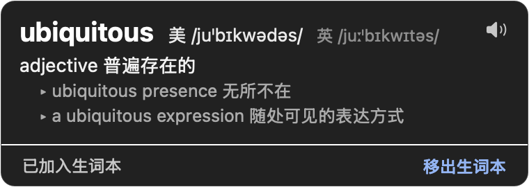
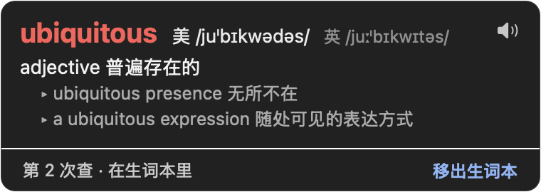

<p align="center"></p>

<h1 align="center">划词查词 WordPop</h1>

<p align="center">Mac 上的全局查词：在任何 App 里双击英文单词，或单按一下 ⌘，就弹出牛津英汉词典的释义。<br>查过的词自动记进生词本，再遇到时标红。</p>

<p align="center"><a href="README.en.md">English</a></p>

<p align="center">
  
  
</p>

## 功能

- **双击或拖选**英文单词就弹出释义，Chrome、Safari、微信、Word、Notion 等都能用
- **单按一下 ⌘**：查选中的文字；没选中就识别鼠标下的单词，图片、截图、视频字幕、中英混排里的词也能查
- **生词本**：查过的词自动加入，再查到时标红并记录次数，一键移出；就是一个纯文本文件
- 用系统自带的牛津英汉汉英词典，离线、查一个词只要几毫秒；美式发音
- 常驻菜单栏，平时约 20 MB 内存、不占 CPU；文字识别在单独的进程里，闲置 3 分钟自动退出

## 安装

1. 从 [Releases](https://github.com/wrab12/wordpop/releases/latest) 下载 `WordPop-x.y.z.dmg`，打开后把 WordPop 拖进「应用程序」。
2. 第一次打开时，macOS 会提示无法验证开发者：点「完成」，再到 **系统设置 → 隐私与安全性**，在页面下方点「仍要打开」。
   也可以在终端里运行：
   ```bash
   xattr -dr com.apple.quarantine /Applications/WordPop.app
   ```
3. 按提示开启权限：
   - **辅助功能**（必需）：读取选中的文字
   - **屏幕录制**（可选）：没选中文字时识别鼠标下的单词
4. 如果菜单里提示没有牛津英汉词典，打开「词典」App → 设置，勾选「简体中文-英文」。

需要 macOS 13 或更高版本（识别屏幕上的文字需要 macOS 15.2 或更高），支持 Apple 芯片和 Intel。

## 使用

| 操作 | 效果 |
|---|---|
| 双击或拖选一个英文单词 | 弹出释义 |
| 单按一下 ⌘（按下马上松开） | 有选中的文字就查选中的，没有就识别鼠标下的词 |
| 卡片上的「移出生词本」 | 从生词本删掉，下次不再标红 |
| 按任意键、点别处或滚动 | 关闭卡片 |

菜单栏图标里可以暂停自动查词、在某个 App 里关掉自动查词（代码编辑器默认关闭）、打开生词本、设置开机自动启动。

## 生词本

文件在 `~/Library/Application Support/WordPop/生词本.txt`，菜单里点「打开生词本」即可。每行一个词：

```
soil	土壤；土地；国土	2026-10-20	2
```

依次是单词、释义、首次查询日期、查询次数。可以直接编辑，删掉一行就是移出生词本。

## 隐私

完全离线。查词用本机的词典，识别文字用本机的 Vision 框架，不联网，不收集任何数据。屏幕录制只在你按 ⌘ 时截取鼠标附近的一小条，不保存。

## 从源码构建

只需要 Xcode Command Line Tools（`xcode-select --install`）：

```bash
./build.sh install   # 编译并安装到 ~/Applications
./build.sh test      # 运行测试
./build.sh release   # 打包 dist/WordPop-x.y.z.dmg 和 .zip
```

发布新版本：改 `mac/Info.plist` 里的版本号，在 `CHANGELOG.md` 里写好更新内容，推送 `vX.Y.Z` 标签，GitHub Actions 会自动构建并发布。

## 许可证

[MIT](LICENSE)
